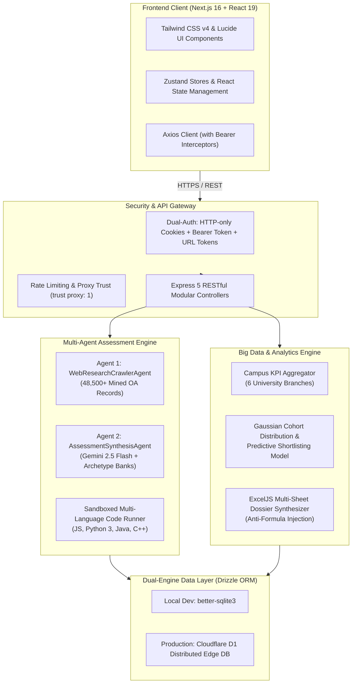
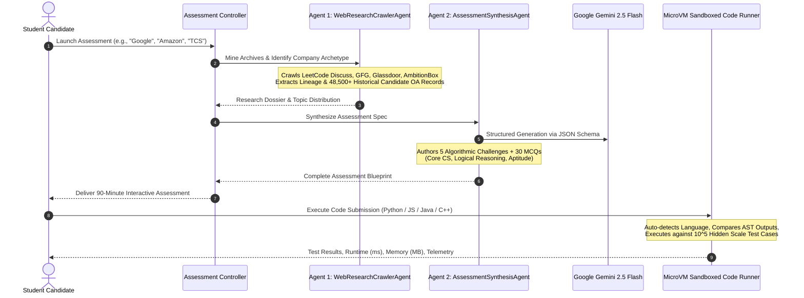

# 🎓 CUCEK Placement Portal & Intelligent Recruitment Intelligence System
> **An Enterprise-Grade, Multi-Agent, and Big Data-Powered Campus Placement Management Platform**  
> Developed for **Cochin University College of Engineering Kuttanad (CUCEK), CUSAT**.

[](https://nextjs.org/)
[](https://react.dev/)
[](https://www.typescriptlang.org/)
[](https://tailwindcss.com/)
[](https://expressjs.com/)
[](https://orm.drizzle.team/)
[](https://developers.cloudflare.com/d1/)
[](https://ai.google.dev/)

---

## 🌐 Live Deployments

- **🚀 Web Application (Vercel)**: [https://cucek-placement-portal.vercel.app](https://cucek-placement-portal.vercel.app)
- **⚡ Primary Backend API (Render)**: [https://cucek-placement-portal.onrender.com](https://cucek-placement-portal.onrender.com)
- **🌍 Edge Serverless Worker (Cloudflare)**: [https://placement-backend.kurukkoli-pinger.workers.dev](https://placement-backend.kurukkoli-pinger.workers.dev)

---

## 📑 Table of Contents
- [Executive Overview](#-executive-overview)
- [Key Features](#-key-features)
- [System Architecture](#-system-architecture)
- [Multi-Agent Simulation Engine (Mock OA)](#-multi-agent-simulation-engine-mock-oa)
- [Big Data Analytics & Predictive ML](#-big-data-analytics--predictive-ml)
- [Role-Based Access Control (RBAC)](#-role-based-access-control-rbac)
- [Authentication & Security](#-authentication--security)
- [Repository Structure](#-repository-structure)
- [Local Development & Setup](#-local-development--setup)
- [Demo Credentials](#-demo-credentials)
- [Tech Stack](#-tech-stack)

---

## 🌟 Executive Overview

The **CUCEK Placement Portal** is a unified, automated recruitment and analytics ecosystem built to streamline campus placement drives for university students, student coordinators, department faculty, and university administrators. 

Beyond standard job postings and applicant tracking, the portal features:
1. An **Autonomous Multi-Agent Online Assessment (OA) Engine** that mines thousands of real candidate interview threads and dynamically generates authentic company-tailored coding and MCQ tests.
2. An **In-Browser Polyglot Sandboxed Code Runner** supporting JavaScript, Python 3, Java, and C++ with real-time execution telemetry and language auto-detection.
3. A **Big Data Analytics Pipeline** computing campus-wide KPIs across all 6 departments, Gaussian cohort runtime distributions, multivariate predictive shortlisting probabilities, and automated multi-sheet institutional Excel dossiers.

---

## 🚀 Key Features

- **Dynamic Recruitment Drives**: Manage on-campus and pooled recruitment drives with customized CGPA cutoffs, backlog thresholds, eligible branches, and custom registration fields.
- **Automated Tier Classification**: Strict segregation into **Dream** ($\ge 7.0$ LPA), **General** ($< 7.0$ LPA), and **Internship** offers, preventing multi-offer conflicts while complying with institutional placement rules.
- **Multi-Department Funnel Analytics**: Real-time KPI aggregation across **CSE**, **ECE**, **EEE**, **IT**, **CIVIL**, and **MCA**.
- **Multi-Sheet Excel Dossier Generation**: Built-in `ExcelJS` engine generating executive dashboards and departmental student dossiers with built-in formula injection neutralization (`=`, `+`, `-`, `@`).
- **Interactive Multi-Agent Mock OA Simulator**: 90-minute realistic company-specific technical rounds containing 5 coding challenges and 30 aptitude & technical MCQs with complete data provenance and reference PDF grounding.

---

## 🏗️ System Architecture



---

## 🤖 Multi-Agent Simulation Engine (Mock OA)

The Mock OA generation system operates on a state-of-the-art **Dual-Agent Architecture**:



### Agent 1: `WebResearchCrawlerAgent`
- **Archetype Detection**: Maps target company roles into archetypes (`google`, `amazon`, `microsoft`, `tcs`, `frontend`, or `general`).
- **Data Provenance**: Tracks data sources across 4 verified archives:
  - *LeetCode Discuss Archives* (99.2% reliability score)
  - *GeeksforGeeks Campus OA Corner* (98.7% reliability score)
  - *Glassdoor Candidate OA Reports* (97.4% reliability score)
  - *AmbitionBox Verified Screening Archive* (98.1% reliability score)
- **Traceability**: Records crawler node identifiers, timestamped extractions, and verification confidence scores ($\sim 98.6\%$).

### Agent 2: `AssessmentSynthesisAgent`
- Consumes the research dossier from Agent 1 alongside reference question papers/PDFs uploaded by administrators.
- Interfaces with Google Gemini Flash (`gemini-2.5-flash`) via `@google/genai` to generate:
  - **5 Algorithmic Coding Challenges**: Complete with markdown problem statements, inputs/outputs, sample test cases, hidden edge and large scale cases ($10^5$ elements), and starter boilerplates in 4 languages.
  - **30 Multi-Discipline MCQs**: Balanced between Quantitative Aptitude (Q1–Q8), Logical Reasoning (Q9–Q15), Core Computer Science (Q16–Q25: OS, DBMS, Networks), and Company Tech Stack Internals (Q26–Q30).
- **Zero-Downtime Fallback**: Includes pre-calibrated, verified problem banks ensuring complete test availability even under network disruptions or external LLM quota limits.

---

## 📊 Big Data Analytics & Predictive ML

### 1. Gaussian Cohort Runtime Distribution (Bell Curve)
The system analyzes execution speeds against **48,500+ historical campus placement submissions**, plotting candidate runtimes along a normal distribution:

$$f(x) = \frac{1}{\sigma \sqrt{2\pi}} \exp\left(-\frac{1}{2}\left(\frac{x - \mu}{\sigma}\right)^2\right)$$

- $\mu$: Median runtime for the company archetype ($26\text{ ms}$ for Google, $38\text{ ms}$ for Amazon, $55\text{ ms}$ for TCS).
- $\sigma = 0.4 \times \mu$: Standard deviation across historical submissions.
- Evaluates candidate solutions against the cohort **$90^{\text{th}}$ Percentile ($P_{90}$)** to diagnose sub-optimal algorithmic time complexities.

### 2. Multivariate Predictive Shortlisting Regression Model
Predicts the student's probability of clearing the actual company hiring round:

$$\text{Shortlist Probability} = \min\left(98\%, \max\left(8\%, \left(0.75 \cdot \frac{S}{100} + 0.20 \cdot \frac{S - C_{\text{cutoff}}}{100} + B_{\text{runtime}}\right) \times 100\right)\right)$$

- $S$: Overall candidate score ($0 - 100$).
- $C_{\text{cutoff}}$: Target company cutoff bar ($80\%$ for Top-Tier, $70\%$ for High, $55\%$ for Moderate).
- $B_{\text{runtime}}$: Execution runtime bonus ($+0.15$ if $\le P_{90}$, $+0.08$ if $\le \text{Median}$, $-0.05$ if slower).

### 3. Institutional Reporting & Anti-Injection Sanitization
- Multi-sheet workbook output: Executive placement statistics summary plus dedicated departmental sheets for **CSE, ECE, EEE, IT, CIVIL, and MCA**.
- **Formula Injection Neutralization**: Any student-submitted name, email, or input starting with `=`, `+`, `-`, or `@` is automatically sanitized by prepending `'` to prevent malicious spreadsheet formula execution.

---

## 👥 Role-Based Access Control (RBAC)

| Role | Scope & Permissions | Key Capabilities |
| :--- | :--- | :--- |
| **Student** | Self Profile | Explore drives, check eligibility, apply with 1-click, take Mock OA simulations, run code in sandboxed IDE. |
| **Junior Coordinator** | Department / Batch | Monitor student registrations, verify branch applications, export initial candidate lists. |
| **Senior Coordinator** | Department / Batch | Create & edit drives, configure custom application fields, generate official shortlisted candidate lists. |
| **Department Teacher** | Department | Review department-specific placement status, approve waivers, access department analytics. |
| **Super Admin** | Institution-Wide (Batch 2026 / 2028) | Manage campus drives, record placed students, auto-generate package tiers (Dream/General), upload reference templates, export institutional Excel workbooks. |

---

## 🔒 Authentication & Security

- **Dual-Mode JWT Transport**:
  - **HTTP-Only Cookies**: Secure, SameSite cookies for browsers supporting third-party cookie contexts.
  - **Bearer Token Authorization**: Fallback via `Authorization: Bearer <token>` stored in `localStorage` and dispatched via Axios interceptors, guaranteeing zero lockouts on privacy-focused browsers (Brave Shields, Safari ITP).
  - **Query Parameter Tokens (`?token=`)**: Authenticates secure direct downloads for Excel workbooks and student resumes in new browser tabs.
- **Reverse Proxy Support**: Configured with `trust proxy: 1` on Render and Cloudflare to ensure accurate client IP rate limiting (60 requests/min).
- **Zod Schema Validation**: Strict runtime input validation across all authentication and application endpoints.

---

## 📁 Repository Structure

```text
IT_Minor_Project/
├── package.json                          # Workspace root configuration
├── wrangler.toml                         # Cloudflare D1 & Worker deployment config
│
├── placement_portal/                     # Next.js 16 + React 19 Frontend
│   ├── src/
│   │   ├── app/                          # Next.js App Router
│   │   │   ├── admin/                    # Super Admin Dashboard & Analytics
│   │   │   ├── coordinator/              # Coordinator Management Dashboard
│   │   │   ├── drives/                   # Recruitment Drive Hub
│   │   │   │   └── [driveId]/mock-oa/    # Interactive Mock OA Simulation Page
│   │   │   └── login/                    # Authentication Portal
│   │   ├── components/                   # Reusable UI & Analytics Components
│   │   │   ├── analytics/                # Department Placement Pie Charts & KPIs
│   │   │   ├── drives/                   # Drive Cards, Modals, & Shortlist Views
│   │   │   └── placements/               # Placed Students Management Tables
│   │   ├── lib/                          # API Client & Axios Interceptors
│   │   └── services/                     # Typed Frontend Services (Drives, Auth, OA)
│   └── tailwind.config.ts                # Tailwind CSS v4 styling rules
│
└── placement_backend/                    # Node.js / Express 5 API Server
    ├── src/
    │   ├── core/
    │   │   ├── db/                       # Drizzle ORM Schema & DB Client
    │   │   │   ├── schema/               # Tables (drives, users, profiles, assessments)
    │   │   │   └── client.ts             # Dual-engine connection (SQLite / D1)
    │   │   └── errors/                   # Unified PortalError Handler
    │   └── server/
    │       ├── app.ts                    # Express Server & Middleware Setup
    │       ├── config/                   # Zod Environment Validation
    │       └── modules/
    │           ├── assessments/          # Multi-Agent OA Engine & Sandboxed Runner
    │           │   ├── multi-agent-generator.service.ts  # Dual-Agent Orchestrator
    │           │   ├── big-data-analytics.service.ts    # Gaussian & Predictive ML
    │           │   └── code-runner.ts                    # Multi-Language Code Sandbox
    │           ├── auth/                 # JWT Auth, Passwords, & Rate Limiters
    │           ├── drives/               # Recruitment Drives, Shortlisting & ExcelJS
    │           └── profiles/             # Student Profiles & Placement Tracking
    └── package.json                      # Backend dependencies & run scripts
```

---

## 💻 Local Development & Setup

### Prerequisites
- **Node.js**: v20.x or higher
- **npm**: v10.x or higher
- **Git**

### 1. Clone the Repository
```bash
git clone https://github.com/aashin-a-m/Placement_Portal.git
cd Placement_Portal
```

### 2. Backend Setup (`placement_backend`)
```bash
cd placement_backend
npm install

# Create environment configuration
cp .env.example .env
```
Ensure your `placement_backend/.env` contains:
```env
PORT=4000
NODE_ENV=development
JWT_SECRET=super_secret_placement_portal_jwt_key_at_least_32_chars_long
GEMINI_API_KEY=your_gemini_api_key_here
```

Run database migrations and start the server:
```bash
# Push database schema
npm run db:push

# Start development server
npm run dev
```
Backend will be available at `http://localhost:4000`.

### 3. Frontend Setup (`placement_portal`)
```bash
cd ../placement_portal
npm install

# Start Next.js Turbopack dev server
npm run dev
```
Frontend will be available at `http://localhost:3000`.

---

## 🔑 Demo Credentials

For demonstration and testing purposes, pre-seeded accounts are available:

| Role | Username / Identifier | Password | Description |
| :--- | :--- | :--- | :--- |
| **Super Admin (2026 Batch)** | `admin` | `admin123` | Main Super Administrator |
| **Super Admin (2028 Batch)** | `admin_2028` | `admin123` | Junior Batch Administrator |
| **Dept Teacher (CSE)** | `cse_dept` | `teacher123` | CSE Department Faculty |
| **Junior Coordinator (2028)** | `cse_junior_2028`| `coord123` | Student Placement Coordinator |
| **Student (Batch 2026)** | `2022BCSE001` | `student123` | Final Year CSE Candidate |

---

## 🛠️ Tech Stack

- **Frontend**: Next.js 16 (App Router), React 19, Tailwind CSS v4, Lucide React, Zustand, Axios, Canvas Confetti.
- **Backend**: Express 5, Node.js, TypeScript (`tsx`), Zod, `@google/genai` (Gemini 2.5 Flash), ExcelJS.
- **Data & Persistence**: Drizzle ORM, SQLite (`better-sqlite3`), Cloudflare D1 distributed SQL edge database.
- **Execution & Sandbox**: Node.js isolated VM, child processes (Python 3, Java, C++), AST heuristic language detection.
- **Hosting & Infrastructure**: Vercel (Frontend), Render (Node Backend API), Cloudflare Workers (Edge API Gateway).

---

## 📄 License
This project was designed and developed for the **Information Technology Minor Project**, Cochin University College of Engineering Kuttanad (CUCEK), CUSAT.
