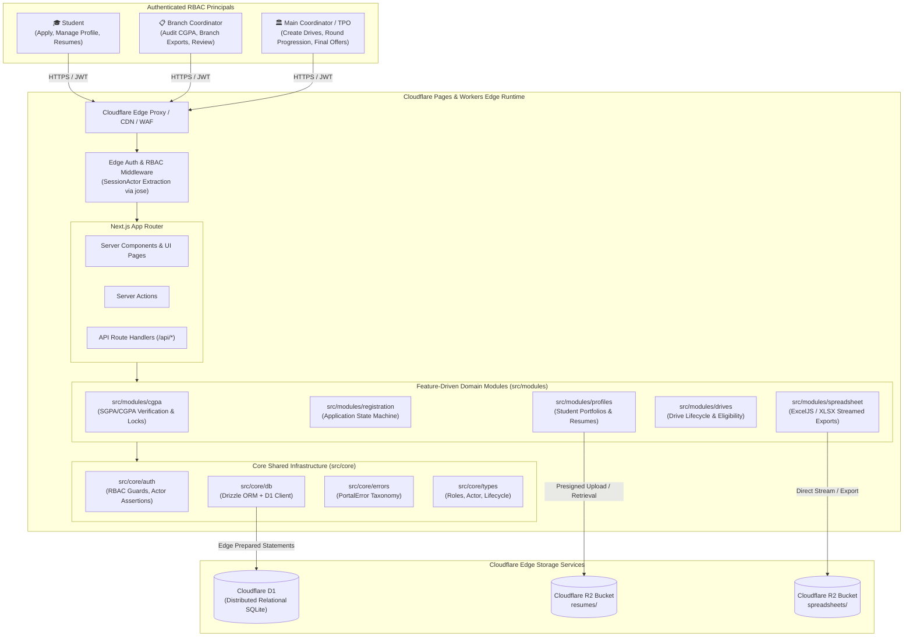
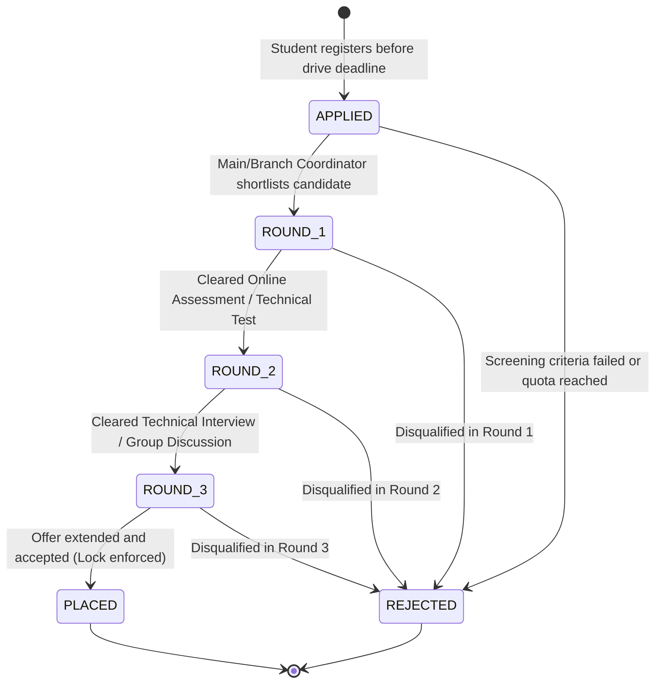
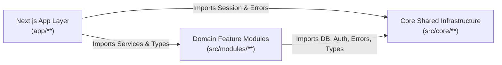

# Placement Portal — System Architecture & Engineering Standard

> **Status:** Step 0 Baseline Specification  
> **Platform:** Next.js App Router on Cloudflare Pages, Cloudflare Workers, Cloudflare D1, Cloudflare R2  
> **Architectural Paradigm:** Edge-First Feature-Driven Modular Architecture (FDMA)

---

## 1. Executive Summary & Architectural Goals

The **Placement Portal** is an edge-native, enterprise-grade university placement management system designed to support high-concurrency recruitment drives, strict academic eligibility verification, and multi-tenant departmental workflows.

### Core Architectural Pillars
- **Edge Performance:** Sub-50ms latency globally utilizing Cloudflare Pages and Workers edge runtimes with zero cold-start overhead.
- **Relational Consistency at the Edge:** Cloudflare D1 (distributed serverless SQLite) paired with **Drizzle ORM** for type-safe schema definitions, edge transactions, and zero-allocation query execution.
- **Object Storage with Edge Direct Access:** Cloudflare R2 for zero-egress storage of student resumes, drive policy briefs, and generated interview spreadsheets.
- **Role-Based Access Control (RBAC):** Strict three-tier permission model (`STUDENT`, `BRANCH_COORDINATOR`, `MAIN_COORDINATOR`) enforced at the edge via cryptographic JWT claims (`jose`) and row-level security (RLS) policies.
- **Resilient Domain Concurrency:** Explicit handling of race conditions during drive registrations, deadline cutoffs, and coordinator evaluation locks via domain-level `PortalError` primitives.

---

## 2. High-Level System Architecture

The following diagram illustrates the interactions between authenticated actors, the Next.js edge execution layer, domain service modules, and Cloudflare distributed infrastructure:



---

## 3. Role-Based Access Control (RBAC) Specification

The system recognizes three explicit roles represented by `UserRole`:

| Role | Scope | Permitted Actions | Restricted Actions |
| :--- | :--- | :--- | :--- |
| **`STUDENT`** | Personal User Scope | Register for eligible drives, upload/preview resume in R2, inspect round status (`ApplicationStatus`), view verified CGPA. | Cannot access other students' records, modify verified CGPA, create drives, or change round states. |
| **`BRANCH_COORDINATOR`** | Departmental Scope (`actor.branch`) | Audit and lock semester SGPA/CGPA, verify academic eligibility, export department-filtered registration sheets, recommend shortlists. | Cannot access cross-branch applicant data or advance drives past institutional milestones. |
| **`MAIN_COORDINATOR`** | Global Institutional Scope (`TPO`) | Full system administration: create/close drives, set CTC/eligibility criteria, advance rounds (`ROUND_1` ➔ `ROUND_2` ➔ `ROUND_3`), mark `PLACED` or `REJECTED`, global Excel exports. | None (Super Admin). |

### The `SessionActor` Contract
Every protected Server Action and API Route extracts and validates a `SessionActor`:
```typescript
export interface SessionActor {
  readonly userId: string;
  readonly role: UserRole;
  readonly branch: string;
}
```
All business services accept `actor: SessionActor` as their first parameter to assert row-level ownership and departmental permissions before executing D1 queries.

---

## 4. Application Status Lifecycle State Machine

Student applications transition through a rigorous state progression defined by `ApplicationStatus`:



### State Transition Rules
1. **Idempotence & Immutability:** Once an application enters a terminal state (`PLACED` or `REJECTED`), it cannot transition to another state without manual TPO override and audit log entry.
2. **Offer Policy Enforcement:** Transition to `PLACED` triggers university policy checks (e.g., maximum offers per student, dream company upgrade rules), automatically withdrawing or locking pending applications for lower-tier drives.

---

## 5. Feature-Driven Modular Architecture (FDMA)

The codebase strictly segregates cross-cutting foundational infrastructure from business features:

```text
src/
├── core/                         # Cross-cutting platform layer
│   ├── auth/                     # Edge JWT validation & SessionActor assertions
│   │   ├── session.ts
│   │   └── rbac.ts
│   ├── db/                       # Cloudflare D1 + Drizzle ORM client & schemas
│   │   ├── client.ts
│   │   ├── schema/
│   │   └── migrations/
│   ├── errors/                   # Domain error taxonomy
│   │   └── portal-error.ts       # PortalError class & ErrorCode union
│   └── types/                    # Core architectural contracts
│       └── roles.ts              # UserRole, ApplicationStatus, SessionActor
│
└── modules/                      # Isolated business feature modules
    ├── cgpa/                     # Academic performance & verification
    ├── registration/             # Drive application state machine
    ├── profiles/                 # Student profile & R2 resume management
    ├── spreadsheet/              # ExcelJS / XLSX bulk export engine
    └── drives/                   # Placement drive CRUD & eligibility engine
```

### Detailed Feature Module Breakdown

#### `src/core/db`
- **Responsibility:** Database client lifecycle, edge connection pooling, Drizzle ORM schema exports, migration tracking, and transaction utilities on Cloudflare D1.
- **Guarantees:** Zero long-running connection overhead; leverages D1's HTTP edge batch API (`db.batch([...])`) to execute atomic multi-statement operations.

#### `src/core/auth`
- **Responsibility:** JWT token signing/verification using `jose` with Web Crypto API compatibility.
- **Guarantees:** Extracts `SessionActor` in middleware and Server Actions without external network round-trips. Enforces branch isolation guards (`assertBranchAccess(actor, targetBranch)`).

#### `src/modules/cgpa`
- **Responsibility:** Records semester-wise SGPA and cumulative CGPA. Coordinates branch coordinator verification and immutable grade locking.
- **Guarantees:** Once verified and locked (`isLocked = true`), grades cannot be mutated by students. Attempted modifications throw `PortalError('ROW_LOCKED')`.

#### `src/modules/registration`
- **Responsibility:** Orchestrates student drive application submission, deadline verification, and application state transitions (`APPLIED` ➔ `PLACED`).
- **Guarantees:** Rejects registrations past deadline (`DEADLINE_EXPIRED`) or for ineligible profiles (`INELIGIBLE`).

#### `src/modules/profiles`
- **Responsibility:** Manages personal info, academic details, skills, and resume PDF attachments stored in Cloudflare R2.
- **Guarantees:** Generates time-bounded presigned R2 URLs for secure direct resume uploads and coordinator previews, preventing unauthorized resume downloads.

#### `src/modules/spreadsheet`
- **Responsibility:** High-speed streaming generation of Excel (`.xlsx`) and CSV reports using `exceljs` and `xlsx`.
- **Guarantees:** Produces coordinator-ready attendance sheets, shortlist templates, and institutional TPO placement metrics without exceeding Worker memory limits.

#### `src/modules/drives`
- **Responsibility:** Manages placement drive creation, company job descriptions, package CTC, tier categorization, and eligibility criteria rules engine.
- **Guarantees:** Enforces optimistic row locking (`ROW_LOCKED`) when coordinators modify round results simultaneously.

---

## 6. Strict Module Coding Standards

To maintain modularity and prevent spaghetti dependencies as the platform scales, every module inside `src/modules/<module>` **MUST** comply with the **Three-File Invariant**:

```text
src/modules/<module>/
├── <module>.types.ts             # 1. Pure domain types & Zod schemas
├── <module>.service.ts           # 2. Pure business logic & D1/R2 operations
└── (index.ts)                    # Optional clean public barrel export

docs/modules/
└── <module>.md                   # 3. Technical specification & RFC document
```

### 1. The `<module>.types.ts` Invariant
- **Rule:** Contains domain models, DTOs, request/response interfaces, and Zod schemas.
- **Constraint:** **ZERO runtime dependencies on database drivers or ORM clients.** Types defined here must be pure TypeScript representations of the business entity.

### 2. The `<module>.service.ts` Invariant
- **Rule:** Encapsulates all domain business logic, data validation, database interactions via Drizzle ORM, and R2 storage operations.
- **Signature Standard:** Every exported service function must take `actor: SessionActor` as its first parameter:
  ```typescript
  export async function registerForDrive(
    actor: SessionActor,
    input: RegisterDriveInput
  ): Promise<DriveRegistrationResult> {
    // 1. Assert actor role & branch scope
    // 2. Validate input schema
    // 3. Verify drive deadline (throw PortalError.deadlineExpired)
    // 4. Verify student eligibility (throw PortalError.ineligible)
    // 5. Execute D1 transaction
  }
  ```
- **Error Standard:** Must throw structured `PortalError` instances with standard `ErrorCode` keys rather than generic untyped errors.

### 3. The `docs/modules/<module>.md` Invariant
- **Rule:** Every module must have a corresponding architectural specification in `docs/modules/<module>.md` prior to merging code.
- **Required Sections:**
  1. Purpose & Business Objective
  2. Data Model & Schema Relationships (Drizzle/D1 tables)
  3. API / Action Endpoints & Signatures
  4. RBAC Permission Matrix
  5. Edge & Concurrency Constraints (Locking, R2 storage, edge limits)

---

## 7. Dependency Flow & Architecture Boundaries



### Architectural Prohibitions
1. ❌ **Core cannot import Modules:** `src/core` must never depend on any file within `src/modules`.
2. ❌ **Circular Module Imports are Prohibited:** `src/modules/registration` must not directly import internal service logic from `src/modules/drives`. Cross-module communication must proceed through public interfaces or orchestrator services.
3. ❌ **No Direct DB Calls in Components:** Server Components and Route Handlers must delegate data access to module services; raw `drizzle` queries are prohibited in UI layers.
4. ❌ **No Node.js Native Dependencies:** Because code executes on Cloudflare Pages/Workers edge runtime, all dependencies must be Web-standard or compatible with Cloudflare's `nodejs_compat` flag (e.g., `jose` for crypto, `exceljs`/`xlsx` for spreadsheets).

---

## 8. Concurrency & Edge Error Handling

### Error Code Taxonomy (`src/core/errors/portal-error.ts`)

| Error Code | HTTP Status | Trigger Condition |
| :--- | :--- | :--- |
| `FORBIDDEN` | 403 | Attempting cross-branch access or insufficient RBAC role. |
| `ROW_LOCKED` | 423 | Modifying a student CGPA marked as locked or concurrent drive update conflict. |
| `DEADLINE_EXPIRED` | 410 | Drive registration or round submission attempted after deadline. |
| `INELIGIBLE` | 422 | CGPA below cutoff, active backlogs, or non-matching department. |
| `VALIDATION_ERROR` | 400 | Malformed payload or Zod schema validation failure. |
| `RATE_LIMITED` | 429 | Edge rate limiter exceeded on submission endpoints. |

All API route handlers and Server Actions catch `PortalError` and format it using `.toJSON()` into a standard response envelope:
```json
{
  "success": false,
  "error": {
    "code": "DEADLINE_EXPIRED",
    "message": "Registration for Google SWE 2026 closed on 2026-10-25T18:00:00.000Z",
    "statusCode": 410
  }
}
```

---

## 9. Verification & Testing Strategy

1. **Vitest Unit & Integration Suite:**
   - Configured with `happy-dom`, `@vitejs/plugin-react`, and `vite-tsconfig-paths`.
   - Path alias `@/*` strictly resolves to `./src/*`.
   - Tests execute in-memory with high-speed mocking of D1 bindings via in-memory SQLite (`better-sqlite3` or D1 mock layer).
2. **Type Safety & Schema Validation:**
   - Full TypeScript strict mode enabled (`strict: true`, `noEmit: true`).
   - Runtime payload parsing via **Zod**.
3. **Cloudflare Local Emulation:**
   - Emulated via `wrangler pages dev` or `wrangler d1` to validate edge runtime constraints before deployment.

