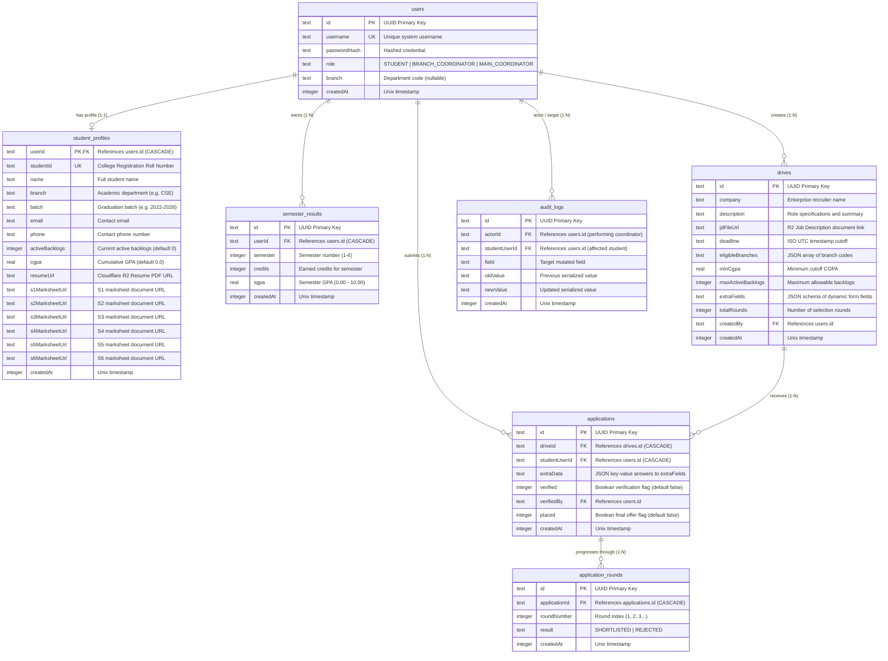

# Placement Portal — Modular Drizzle ORM Database Schema

> **Specification Revision:** 2.0.0 (Relational Normalization & Round Lifecycle)  
> **Engines Supported:** SQLite (better-sqlite3 / Cloudflare D1)  
> **ORM Layer:** Drizzle ORM (`drizzle-orm/sqlite-core`)  
> **Source Definitions:** `src/core/db/schema/`

---

## 1. Overview & Architectural Principles

The database schema is normalized to decouple student academic semester records, dynamic recruitment drive requirements, and multi-round candidate selection outcomes while enforcing strict relational integrity, foreign key cascading, and unique constraints.

### Core Architectural Guarantees
1. **Foreign Key Integrity & Cascades:** SQLite foreign keys are explicitly enforced (`PRAGMA foreign_keys = ON`). Deleting a user automatically cascades to their `student_profiles`, `semester_results`, and `applications`.
2. **Indexed Foreign Keys:** Every foreign key column has a dedicated SQLite index to prevent full table scans during joins and cascade resolutions.
3. **Multi-Column Uniqueness Constraints:**
   - `student_profiles(studentId)`: Unique university college roll number.
   - `semester_results(userId, semester)`: At most one SGPA/credit record per student semester.
   - `applications(driveId, studentUserId)`: Strictly one application per student per drive.
   - `application_rounds(applicationId, roundNumber)`: Sequential, non-duplicable round evaluations.
4. **Data Sanitization Rule:** Sensitive credential fields (`passwordHash`) are never exposed across public query facades or API responses.

---

## 2. Entity-Relationship (ER) Diagram



---

## 3. Data Dictionary & Detailed Schema Specifications

### 3.1. `users` Table
- **File:** `src/core/db/schema/users.schema.ts`
- **Description:** System identity table managing authentication and role-based access.

| Column | Type | Constraints | Description |
| :--- | :--- | :--- | :--- |
| `id` | `TEXT` | `PRIMARY KEY` | UUID string identifier. |
| `username` | `TEXT` | `NOT NULL`, `UNIQUE` | Unique user handle (roll number or employee code). |
| `passwordHash` | `TEXT` | `NOT NULL` | Argon2id / bcrypt password hash. |
| `role` | `TEXT` | `NOT NULL`, `DEFAULT 'STUDENT'` | Enum: `STUDENT`, `BRANCH_COORDINATOR`, `MAIN_COORDINATOR`. |
| `branch` | `TEXT` | `NULLABLE` | Academic department code (e.g. `'CSE'`, `'ECE'`, or `null` for Main TPO). |
| `createdAt` | `INTEGER` | `NOT NULL`, `DEFAULT (unixepoch())` | Account creation timestamp. |

---

### 3.2. `student_profiles` Table
- **File:** `src/core/db/schema/profiles.schema.ts`
- **Description:** Student demographic and cumulative academic summary with individual marksheet document links.

| Column | Type | Constraints | Description |
| :--- | :--- | :--- | :--- |
| `userId` | `TEXT` | `PRIMARY KEY`, `FK ➔ users.id (CASCADE)` | User identity reference. |
| `studentId` | `TEXT` | `NOT NULL`, `UNIQUE` | College roll number (e.g. `'2022BCSE001'`). |
| `name` | `TEXT` | `NULLABLE` | Full student name. |
| `branch` | `TEXT` | `NULLABLE` | Department branch abbreviation. |
| `batch` | `TEXT` | `NULLABLE` | Graduation cohort (e.g. `'2022-2026'`). |
| `email` | `TEXT` | `NULLABLE` | Primary institutional / personal email. |
| `phone` | `TEXT` | `NULLABLE` | Contact phone number. |
| `activeBacklogs` | `INTEGER` | `NOT NULL`, `DEFAULT 0` | Standing active backlogs. |
| `cgpa` | `REAL` | `NOT NULL`, `DEFAULT 0` | Verified cumulative GPA (0.00 - 10.00). |
| `resumeUrl` | `TEXT` | `NULLABLE` | Cloudflare R2 resume PDF link. |
| `s1MarksheetUrl`..`s6MarksheetUrl` | `TEXT` | `NULLABLE` | Semester 1 through 6 marksheet PDF links. |
| `createdAt` | `INTEGER` | `NOT NULL`, `DEFAULT (unixepoch())` | Record creation timestamp. |

**Indexes:**
- `student_profiles_user_id_idx` on `(userId)`
- Unique index on `(studentId)`

---

### 3.3. `semester_results` Table
- **File:** `src/core/db/schema/profiles.schema.ts`
- **Description:** Normalized semester performance tracking credits and SGPA.

| Column | Type | Constraints | Description |
| :--- | :--- | :--- | :--- |
| `id` | `TEXT` | `PRIMARY KEY` | UUID string. |
| `userId` | `TEXT` | `NOT NULL`, `FK ➔ users.id (CASCADE)` | Student user reference. |
| `semester` | `INTEGER` | `NOT NULL` | Semester index (1 through 6). |
| `credits` | `INTEGER` | `NOT NULL`, `DEFAULT 0` | Earned credits in the semester. |
| `sgpa` | `REAL` | `NOT NULL`, `DEFAULT 0` | Semester Grade Point Average. |
| `createdAt` | `INTEGER` | `NOT NULL`, `DEFAULT (unixepoch())` | Timestamp. |

**Indexes & Constraints:**
- `UNIQUE INDEX semester_results_user_semester_idx` on `(userId, semester)`
- `INDEX semester_results_user_id_idx` on `(userId)`

---

### 3.4. `audit_logs` Table
- **File:** `src/core/db/schema/profiles.schema.ts`
- **Description:** Granular audit trail capturing field-level changes made by coordinators.

| Column | Type | Constraints | Description |
| :--- | :--- | :--- | :--- |
| `id` | `TEXT` | `PRIMARY KEY` | UUID string. |
| `actorId` | `TEXT` | `NOT NULL`, `FK ➔ users.id` | Coordinator or user performing modification. |
| `studentUserId` | `TEXT` | `NULLABLE`, `FK ➔ users.id (CASCADE)` | Target student whose record was modified. |
| `field` | `TEXT` | `NOT NULL` | Name of modified property (e.g. `'cgpa'`, `'activeBacklogs'`). |
| `oldValue` | `TEXT` | `NULLABLE` | Previous value serialized as string. |
| `newValue` | `TEXT` | `NULLABLE` | New value serialized as string. |
| `createdAt` | `INTEGER` | `NOT NULL`, `DEFAULT (unixepoch())` | Audit log timestamp. |

**Indexes:**
- `INDEX audit_logs_actor_id_idx` on `(actorId)`
- `INDEX audit_logs_student_user_id_idx` on `(studentUserId)`

---

### 3.5. `drives` Table
- **File:** `src/core/db/schema/drives.schema.ts`
- **Description:** Company campus placement drives with dynamic requirements and eligibility criteria.

| Column | Type | Constraints | Description |
| :--- | :--- | :--- | :--- |
| `id` | `TEXT` | `PRIMARY KEY` | UUID string. |
| `company` | `TEXT` | `NOT NULL` | Company / enterprise name. |
| `description` | `TEXT` | `NULLABLE` | Job role description and expectations. |
| `jdFileUrl` | `TEXT` | `NULLABLE` | Link to Job Description PDF on R2. |
| `deadline` | `TEXT` | `NOT NULL` | ISO 8601 UTC timestamp cutoff for registrations. |
| `eligibleBranches` | `TEXT` | `NOT NULL` | JSON array of eligible department codes (e.g. `["CSE","IT"]`). |
| `minCgpa` | `REAL` | `NOT NULL`, `DEFAULT 0` | Minimum CGPA threshold. |
| `maxActiveBacklogs` | `INTEGER` | `NOT NULL`, `DEFAULT 0` | Maximum standing backlogs permitted. |
| `extraFields` | `TEXT` | `DEFAULT '[]'` | JSON schema for custom dynamic form questions. |
| `totalRounds` | `INTEGER` | `NOT NULL`, `DEFAULT 1` | Total interview/evaluation stages planned. |
| `createdBy` | `TEXT` | `NOT NULL`, `FK ➔ users.id` | Coordinator who posted the drive. |
| `createdAt` | `INTEGER` | `NOT NULL`, `DEFAULT (unixepoch())` | Posting timestamp. |

**Indexes:**
- `INDEX drives_created_by_idx` on `(createdBy)`

---

### 3.6. `applications` Table
- **File:** `src/core/db/schema/drives.schema.ts`
- **Description:** Student applications to specific recruitment drives.

| Column | Type | Constraints | Description |
| :--- | :--- | :--- | :--- |
| `id` | `TEXT` | `PRIMARY KEY` | UUID string. |
| `driveId` | `TEXT` | `NOT NULL`, `FK ➔ drives.id (CASCADE)` | Placement drive reference. |
| `studentUserId` | `TEXT` | `NOT NULL`, `FK ➔ users.id (CASCADE)` | Applying student user reference. |
| `extraData` | `TEXT` | `NULLABLE` | JSON object storing student answers to `extraFields`. |
| `verified` | `INTEGER` | `NOT NULL`, `DEFAULT 0` | Boolean verification flag by coordinator. |
| `verifiedBy` | `TEXT` | `NULLABLE`, `FK ➔ users.id` | Coordinator who approved the application. |
| `placed` | `INTEGER` | `NOT NULL`, `DEFAULT 0` | Boolean terminal success offer flag. |
| `createdAt` | `INTEGER` | `NOT NULL`, `DEFAULT (unixepoch())` | Application timestamp. |

**Indexes & Constraints:**
- `UNIQUE INDEX applications_drive_student_idx` on `(driveId, studentUserId)`
- `INDEX applications_drive_id_idx` on `(driveId)`
- `INDEX applications_student_user_id_idx` on `(studentUserId)`
- `INDEX applications_verified_by_idx` on `(verifiedBy)`

---

### 3.7. `application_rounds` Table
- **File:** `src/core/db/schema/drives.schema.ts`
- **Description:** Round-wise screening and interview outcomes.

| Column | Type | Constraints | Description |
| :--- | :--- | :--- | :--- |
| `id` | `TEXT` | `PRIMARY KEY` | UUID string. |
| `applicationId` | `TEXT` | `NOT NULL`, `FK ➔ applications.id (CASCADE)` | Drive application reference. |
| `roundNumber` | `INTEGER` | `NOT NULL` | Sequential evaluation round index (1, 2, 3...). |
| `result` | `TEXT` | `NOT NULL` | Outcome enum: `'SHORTLISTED'` or `'REJECTED'`. |
| `createdAt` | `INTEGER` | `NOT NULL`, `DEFAULT (unixepoch())` | Round recording timestamp. |

**Indexes & Constraints:**
- `UNIQUE INDEX application_rounds_app_round_idx` on `(applicationId, roundNumber)`
- `INDEX application_rounds_app_id_idx` on `(applicationId)`

---

## 4. Inferred TypeScript Types

Exported from `src/core/db/index.ts`:

```typescript
// Users
export type User = InferSelectModel<typeof users>;
export type NewUser = InferInsertModel<typeof users>;

// Profiles & Results
export type StudentProfile = InferSelectModel<typeof studentProfiles>;
export type NewStudentProfile = InferInsertModel<typeof studentProfiles>;
export type SemesterResult = InferSelectModel<typeof semesterResults>;
export type NewSemesterResult = InferInsertModel<typeof semesterResults>;
export type AuditLog = InferSelectModel<typeof auditLogs>;
export type NewAuditLog = InferInsertModel<typeof auditLogs>;

// Drives & Applications
export type Drive = InferSelectModel<typeof drives>;
export type NewDrive = InferInsertModel<typeof drives>;
export type Application = InferSelectModel<typeof applications>;
export type NewApplication = InferInsertModel<typeof applications>;
export type ApplicationRound = InferSelectModel<typeof applicationRounds>;
export type NewApplicationRound = InferInsertModel<typeof applicationRounds>;
```
