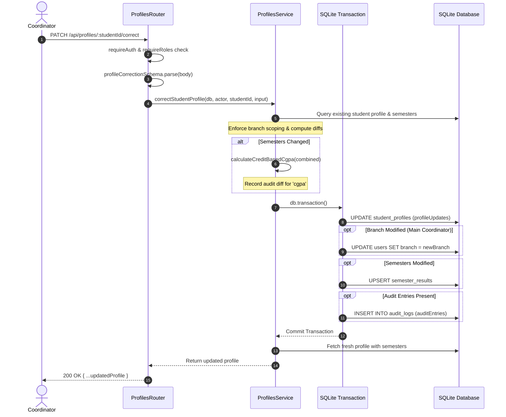

# Module Specification: Student Profiles & Corrections (`profiles`)

> **Module Path:** `src/server/modules/profiles/`  
> **Mounted At:** `/api/profiles`  
> **Route Identifier:** `:studentId` is the unique college roll number (e.g., `'2022BCSE001'`)

---

## 1. Overview & Architectural Principles

The `profiles` module manages student academic profiles, coordinator data corrections, and tamper-proof field-level audit logging.

Key architectural guarantees:
1. **Strict RBAC Scoping:**
   - **Students:** Can only read their own profile (`/api/profiles/me` or `/api/profiles/:studentId` matching their user ID). Students get `403 FORBIDDEN` on any correction or audit log retrieval.
   - **Branch Coordinators:** Restricted exclusively to students within their assigned `branch`. They cannot view or correct students in other branches, and they are forbidden from moving a student to a different branch.
   - **Main Coordinators:** Have unrestricted access to view, list, and correct any student across any branch, including reassigning branches (which updates both `student_profiles` and `users` tables).
2. **Whitelist-Only Field Correction:**
   - Evaluated using Zod `.strict()`. Any unrecognized or extra fields in the correction request body immediately trigger a `400 VALIDATION_ERROR`.
3. **Atomic Transactions & Minimal Audit Diffing:**
   - Updates, semester adjustments, CGPA recalculations, and audit entries execute in **one atomic SQLite transaction**.
   - Exactly one audit row is recorded per scalar field that actually mutated (`oldValue !== newValue`).
   - If semester results change, CGPA is recomputed across all existing and modified semesters via `calculateCreditBasedCgpa`, stored in `studentProfiles.cgpa`, and an audit row for `field = 'cgpa'` is created.
   - **No-Op Guarantee:** A patch containing identical or unchanged values writes **zero** audit log rows.
   - **Rollback Guarantee:** Failure during any step within the transaction triggers an immediate rollback, leaving zero partial audit rows and no partial database writes.

---

## 2. RBAC Access Scoping Matrix

| Endpoint | `STUDENT` | `BRANCH_COORDINATOR` | `MAIN_COORDINATOR` |
| :--- | :--- | :--- | :--- |
| `GET /api/profiles/me` | `200 OK` (Own profile) | `403 FORBIDDEN` | `403 FORBIDDEN` |
| `GET /api/profiles/:studentId` | `200 OK` (Own only; other $\to$ `403`) | `200 OK` (Own branch only; other $\to$ `403`) | `200 OK` (Any student) |
| `GET /api/profiles?branch=` | `403 FORBIDDEN` | `200 OK` (Strictly forced to own branch) | `200 OK` (Filterable by branch) |
| `PATCH /api/profiles/:studentId/correct` | `403 FORBIDDEN` | `200 OK` (Own branch only; cannot reassign branch) | `200 OK` (Any student, can reassign branch) |
| `GET /api/profiles/:studentId/audit-logs` | `403 FORBIDDEN` | `200 OK` (Own branch only) | `200 OK` (Any student) |

---

## 3. Zod Whitelist Schema (`profileCorrectionSchema`)

Input validation strictly whitelists the following mutable fields:

```typescript
export const profileCorrectionSchema = z
  .object({
    name: z.string().trim().min(1).optional(),
    branch: z.string().trim().min(1).optional(),
    batch: z.string().trim().min(1).optional(),
    email: z.string().trim().email().optional(),
    phone: z.string().trim().regex(/^\d{10}$/).optional(),
    activeBacklogs: z.coerce.number().int().min(0).optional(),
    resumeUrl: z.string().trim().optional().nullable(),
    s1MarksheetUrl: z.string().trim().optional().nullable(),
    s2MarksheetUrl: z.string().trim().optional().nullable(),
    s3MarksheetUrl: z.string().trim().optional().nullable(),
    s4MarksheetUrl: z.string().trim().optional().nullable(),
    s5MarksheetUrl: z.string().trim().optional().nullable(),
    s6MarksheetUrl: z.string().trim().optional().nullable(),
    semesters: z.array(
      z.object({
        semester: z.coerce.number().int().min(1).max(6),
        credits: z.coerce.number().int().min(0),
        sgpa: z.coerce.number().min(0).max(10),
      })
    ).optional(),
  })
  .strict();
```

---

## 4. Correction & Audit Workflow



---

## 5. API Reference

### 5.1. `GET /api/profiles/me`
- **Role:** `STUDENT` only.
- **Response (`200 OK`):**
  ```json
  {
    "userId": "usr_123",
    "studentId": "2022BCSE001",
    "name": "Alice CSE",
    "branch": "CSE",
    "batch": "2022-2026",
    "email": "alice@college.edu",
    "phone": "9876543210",
    "activeBacklogs": 0,
    "cgpa": 8.5,
    "resumeUrl": "https://storage.college.edu/resumes/alice.pdf",
    "s1MarksheetUrl": null,
    "s2MarksheetUrl": null,
    "s3MarksheetUrl": null,
    "s4MarksheetUrl": null,
    "s5MarksheetUrl": null,
    "s6MarksheetUrl": null,
    "createdAt": "2026-10-30T10:00:00.000Z",
    "semesters": [
      {
        "id": "sem-1",
        "userId": "usr_123",
        "semester": 1,
        "credits": 20,
        "sgpa": 8.5,
        "createdAt": "2026-10-30T10:00:00.000Z"
      }
    ]
  }
  ```

### 5.2. `GET /api/profiles/:studentId`
- **Role:** Authenticated users (scoped).
- **Parameters:** `:studentId` (string, e.g. `'2022BCSE001'`).
- **Response (`200 OK`):** Full student profile object with `semesters` array.
- **Errors:** `401 UNAUTHORIZED`, `403 FORBIDDEN`, `404 NOT_FOUND`.

### 5.3. `GET /api/profiles?branch=`
- **Role:** `MAIN_COORDINATOR`, `BRANCH_COORDINATOR`.
- **Query Params:** `branch` (optional string).
- **Behavior:**
  - `BRANCH_COORDINATOR` results are strictly forced to `actor.branch`.
  - `MAIN_COORDINATOR` can view all or filter by `?branch=ECE`.
- **Response (`200 OK`):** `StudentProfile[]`.

### 5.4. `PATCH /api/profiles/:studentId/correct`
- **Role:** `MAIN_COORDINATOR`, `BRANCH_COORDINATOR`.
- **Request Body:** Whitelisted correction fields (`profileCorrectionSchema`).
- **Response (`200 OK`):** Refreshed student profile with updated calculations.
- **Errors:**
  - `400 VALIDATION_ERROR`: Unknown fields or invalid values.
  - `403 FORBIDDEN`: Student access, cross-branch coordinator access, or coordinator moving student branch.
  - `404 NOT_FOUND`: Student does not exist.

### 5.5. `GET /api/profiles/:studentId/audit-logs`
- **Role:** `MAIN_COORDINATOR`, `BRANCH_COORDINATOR`.
- **Response (`200 OK`):**
  ```json
  [
    {
      "id": "audit-uuid",
      "actorId": "usr_coord_1",
      "studentUserId": "usr_123",
      "field": "cgpa",
      "oldValue": "8",
      "newValue": "8.5",
      "createdAt": "2026-10-30T12:00:00.000Z"
    }
  ]
  ```

---

## 6. Test Suite Coverage

The test suite in `src/server/modules/profiles/profiles.routes.test.ts` executes 25 tests verifying:
- Student patch rejection with `403` and zero database mutations.
- Branch coordinator successful updates on own branch (`200 OK`).
- Branch coordinator rejection on other branches (`403 FORBIDDEN`).
- Branch coordinator rejection when attempting to change a student's branch (`403 FORBIDDEN`).
- Rejection of unrecognized payload properties (`400 VALIDATION_ERROR`).
- Accurate audit diff recording with `oldValue`, `newValue`, `actorId`, and `studentUserId`.
- No-op patch producing zero audit rows.
- SGPA updates triggering automated CGPA recalculation and an audit log for `field = 'cgpa'`.
- Transaction rollback on failure guaranteeing zero partial audit rows and no profile corruption.
- Route authorization and scoping across all five API endpoints.

