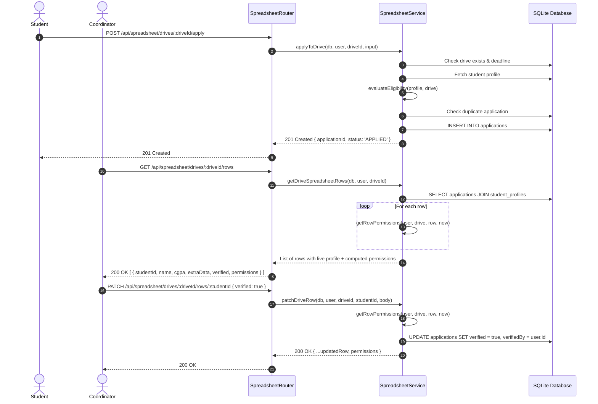

# Module Specification: Live Drive Spreadsheet & Row Permissions (`spreadsheet`)

> **Module Path:** `src/server/modules/spreadsheet/`  
> **Mounted At:** `/api/spreadsheet`  
> **Core Entity:** `applications` table joined with `student_profiles`

---

## 1. Overview & Architectural Principles

The `spreadsheet` module provides an interactive, collaborative grid interface for company recruitment drives. It powers the candidate tracking spreadsheet where:
- Students submit initial applications and maintain dynamic `extraData` answers before the drive deadline.
- Coordinators review candidate profiles, edit auxiliary fields, and verify student rows (even after deadlines have elapsed).
- Profile columns (such as `name`, `branch`, `cgpa`) remain immutable from this interface to protect data integrity.

### Core Architectural Invariants
1. **Asymmetric Deadline Enforcement:**
   - The drive deadline restricts **students only**. Students cannot apply or edit `extraData` once `now > deadline` (rejected with status `403` and code `DEADLINE_PASSED`).
   - Coordinators verify and update rows primarily **after** the deadline has passed.
2. **Deterministic Pure Permission Resolution (`getRowPermissions`):**
   - Pure function taking `(user, drive, row, now)` and computing `{ canEditExtraData, canVerify, locked, reason }`.
   - No external I/O or database queries inside the permission calculation.
3. **Strict Whitelist & Profile Protection:**
   - The PATCH endpoint strictly permits `{ extraData?, verified? }`.
   - Any attempt to submit profile fields (e.g. `name`, `cgpa`, `branch`) is rejected with `400 VALIDATION_ERROR`, leaving the database untouched.
   - Students cannot self-verify; sending `verified` triggers `403 FORBIDDEN`.

---

## 2. Pure Function: `getRowPermissions`

```typescript
export function getRowPermissions(
  user: SpreadsheetActor,
  drive: DriveDeadlineTarget,
  row: DriveRowTarget,
  now: Date = new Date()
): RowPermissions {
  if (user.role === 'MAIN_COORDINATOR') {
    return { canEditExtraData: true, canVerify: true, locked: false, reason: null };
  }

  if (user.role === 'BRANCH_COORDINATOR') {
    if (row.branch === user.branch) {
      return { canEditExtraData: true, canVerify: true, locked: false, reason: null };
    }
    return {
      canEditExtraData: false,
      canVerify: false,
      locked: true,
      reason: 'Branch coordinator can only manage rows in their own branch',
    };
  }

  if (user.role === 'STUDENT') {
    if (user.id !== row.studentUserId) {
      return {
        canEditExtraData: false,
        canVerify: false,
        locked: true,
        reason: 'Students can only access their own row',
      };
    }

    const deadlineTime = new Date(drive.deadline).getTime();
    if (now.getTime() > deadlineTime) {
      return {
        canEditExtraData: false,
        canVerify: false,
        locked: true,
        reason: 'Application deadline has passed',
      };
    }

    if (row.verified) {
      return {
        canEditExtraData: false,
        canVerify: false,
        locked: true,
        reason: 'Row is verified and locked against student modifications',
      };
    }

    return { canEditExtraData: true, canVerify: false, locked: false, reason: null };
  }

  return { canEditExtraData: false, canVerify: false, locked: true, reason: 'Unauthorized role' };
}
```

---

## 3. Permissions Matrix

| Role | Row Target | Deadline Status | Verification Status | `canEditExtraData` | `canVerify` | `locked` |
| :--- | :--- | :--- | :--- | :--- | :--- | :--- |
| `STUDENT` | Own row | Before deadline | Unverified | **`true`** | `false` | `false` |
| `STUDENT` | Own row | After deadline | Unverified | `false` | `false` | **`true`** |
| `STUDENT` | Own row | Before deadline | Verified | `false` | `false` | **`true`** |
| `STUDENT` | Other student | Any | Any | `false` | `false` | **`true`** |
| `BRANCH_COORDINATOR` | Own branch | Before deadline | Any | **`true`** | **`true`** | `false` |
| `BRANCH_COORDINATOR` | Own branch | After deadline | Any | **`true`** | **`true`** | `false` |
| `BRANCH_COORDINATOR` | Other branch | Any | Any | `false` | `false` | **`true`** |
| `MAIN_COORDINATOR` | Any row | Any | Any | **`true`** | **`true`** | `false` |

---

## 4. Drive Spreadsheet Interaction Flow



---

## 5. API Reference

### 5.1. `POST /api/spreadsheet/drives/:driveId/apply`
- **Role:** `STUDENT` only.
- **Request Body:** `{ extraData?: Record<string, unknown> }`.
- **Validation:**
  - Enforces `evaluateEligibility(profile, drive)`.
  - Rejects with `403 DEADLINE_PASSED` if `now > deadline`.
  - Rejects with `403 INELIGIBLE` if criteria are not met.
  - Rejects with `409 CONFLICT` if student has already applied.
- **Response (`201 Created`):**
  ```json
  {
    "applicationId": "app_uuid",
    "driveId": "drv_uuid",
    "status": "APPLIED"
  }
  ```

### 5.2. `GET /api/spreadsheet/drives/:driveId/rows`
- **Role:** All authenticated roles.
- **Scoping:**
  - `STUDENT`: Returns only their own row.
  - `BRANCH_COORDINATOR`: Returns only students in their branch.
  - `MAIN_COORDINATOR`: Returns all candidate rows.
- **Response (`200 OK`):**
  ```json
  [
    {
      "applicationId": "app_uuid",
      "studentUserId": "usr_uuid",
      "studentId": "2022BCSE001",
      "name": "Alice CSE",
      "branch": "CSE",
      "batch": "2022-2026",
      "email": "alice@college.edu",
      "phone": "9876543210",
      "activeBacklogs": 0,
      "cgpa": 8.5,
      "resumeUrl": "https://storage.college.edu/resumes/alice.pdf",
      "extraData": { "github": "https://github.com/alice", "workMode": "Remote" },
      "verified": false,
      "verifiedBy": null,
      "placed": false,
      "permissions": {
        "canEditExtraData": true,
        "canVerify": false,
        "locked": false,
        "reason": null
      }
    }
  ]
  ```

### 5.3. `PATCH /api/spreadsheet/drives/:driveId/rows/:studentId`
- **Role:** Authenticated users (scoped).
- **Request Body:** Whitelisted fields `{ extraData?: Record<string, unknown>, verified?: boolean }`.
- **Validation:**
  - Strict whitelisting (`patchRowSchema.strict()`). Core profile keys (`name`, `cgpa`, etc.) trigger `400 VALIDATION_ERROR`.
  - `extraData` is validated against `drive.extraFields` (required presence, numbers, dropdown options, and rejects unknown keys).
  - Students attempting to send `verified` receive `403 FORBIDDEN`.
  - Student edits after the deadline receive `403 DEADLINE_PASSED`.
  - Verified rows lock student edits (`403 ROW_LOCKED`).
  - Branch coordinators editing other-branch students receive `403 FORBIDDEN`.
- **Response (`200 OK`):** Updated row entity with refreshed permissions object.

---

## 6. Test Suite Coverage

1. **Unit Tests (`spreadsheet.service.test.ts`):**
   - 9 matrix test cases for `getRowPermissions` testing student (own/other, before/after deadline, verified/unverified), branch coordinator (own/other branch), and main coordinator.
   - 5 unit test cases for `validateExtraData` (valid payload, unknown keys, missing required fields, non-numeric values, and invalid dropdown choices).
2. **Integration Tests (`spreadsheet.routes.test.ts`):**
   - Student edits own row successfully (`200 OK`).
   - Student edits another student's row rejected (`403 FORBIDDEN`).
   - Student sends profile fields (`name`, `cgpa`) rejected (`400 VALIDATION_ERROR`) and DB remains unchanged.
   - Student editing after the deadline blocked (`403 DEADLINE_PASSED`).
   - Coordinator verifies row after the deadline successfully (`200 OK`).
   - Branch coordinator editing or verifying other branch student rejected (`403 FORBIDDEN`).
   - Invalid dropdown option rejected (`400 VALIDATION_ERROR`).
   - Ineligible student cannot apply (`403 INELIGIBLE`).
   - Duplicate application rejected (`409 CONFLICT`).
   - Students cannot self-verify (`403 FORBIDDEN`).
   - Row listing scopes accurately for student (1 row), branch coordinator (own branch only), and main coordinator (all).

